# 📈 Bonistas Monitor: arbitraje de bonos argentinos

Monitor local para detectar **desarbitrajes en bonos soberanos argentinos**, con puntas reales, costos incluidos y profundidad del libro. Detecta:

- diferencias entre **Contado Inmediato y 24hs** de la misma especie, con el **corte de cupón** descontado;
- el **dólar MEP / CCL implícito ejecutable** de cada bono y las idas y vueltas pesos ↔ dólares entre bonos;
- desvíos en los **ratios AL/GD** (ley local vs. Nueva York) y entre bonos de la curva.

Cuando aparece una oportunidad que supera la ganancia neta mínima, avisa con una **notificación de Windows** y en el **dashboard**.

> ⚠️ Herramienta personal de análisis. **No es asesoramiento financiero** y no ejecuta órdenes: siempre confirmá precios en tu broker antes de operar.

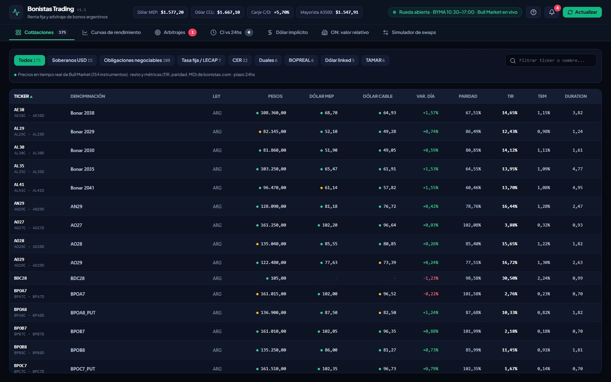

---

## ✨ Funcionalidades

| | |
|---|---|
| **CI vs 24hs** | Para cada especie con puntas en ambos plazos calcula las dos direcciones. **Vender CI / comprar 24hs:** `(compradora CI − cupón) / vendedora 24hs − 1`. **Comprar CI / vender 24hs:** `(compradora 24hs + cupón) / vendedora CI − 1`, menos la caución por los días entre liquidaciones. A las dos les resta el costo de las dos operaciones. Si el bono paga renta o amortización entre las dos liquidaciones, el pago se descuenta; si no hay cronograma conocido, **no se emite señal**. |
| **Dólar implícito** | TC de compra y de venta de dólares con cada bono (pesos ↔ D/C), con puntas y costos, en todas las combinaciones de plazo. Muestra la mejor ida y vuelta entre bonos. |
| **Ratios** | AL/GD y pares de curva (AE38/GD35, GD38/GD41, …), con los nominales que se obtienen al rotar ya descontados los costos. El z-score se calcula con la historia diaria real: las reglas estadísticas solo actúan con ≥ 20 ruedas. |
| **Profundidad** | Recorre el libro hasta cubrir el **tamaño de operación** configurado (USD 500 por defecto). Si la punta no alcanza, no hay señal. |
| **Tiempo real** | Puntas de **BYMA Open Data**, con 20 min de demora, y, opcionalmente, de **Bull Market** en tiempo real con 5 niveles, usando la sesión del propio usuario. Cada señal indica de dónde salieron sus precios: *confirmada en tiempo real*, *parcial* o *demora 20 min*. |
| **Alertas** | Notificación de Windows y panel en el dashboard para oportunidades nuevas, oportunidades confirmadas en tiempo real, sesión vencida y fuentes caídas, con un período de silencio contra las puntas que oscilan. |
| **Curvas** | Por familia: soberanos USD (Bonares vs Globales y BOPREAL), tasa fija (TEM vs. días), CER (TIR real), provinciales, dollar linked y TAMAR/duales. Cada una tiene su curva ajustada y el **desvío de cada bono en puntos básicos** (cuánto rinde de más o de menos que sus vecinos). Incluye **Argentina vs. región** con el spread contra Treasuries por tramo. |
| **Analítica** | TIR, duration modificada, valor técnico, paridad, breakeven de inflación (tasa fija vs. CER) y simulador de swaps entre bonos. |
| **Parámetros** | Costo por operación (0,11% todo incluido), ganancia neta mínima (0,40%) y tamaño de operación, **editables desde el dashboard**. |

---

## 🖼️ Capturas

### Curvas de rendimiento por familia
Un punto por bono, con la curva ajustada (punteada). En la tabla lateral, el desvío de cada bono contra su curva.

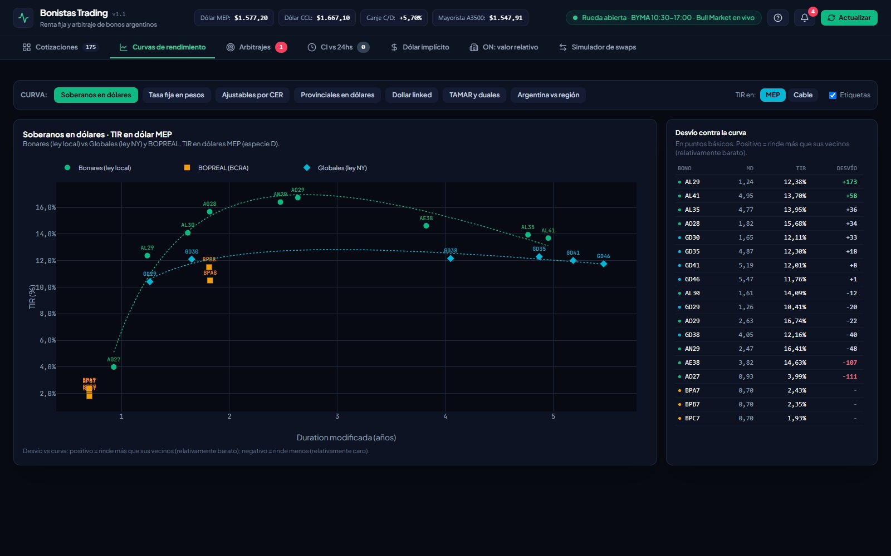

| Desvío contra la curva | Tasa fija (TEM vs. días) |
|---|---|
| 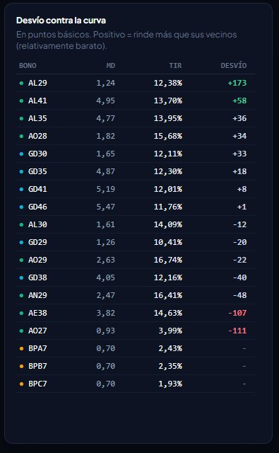 | 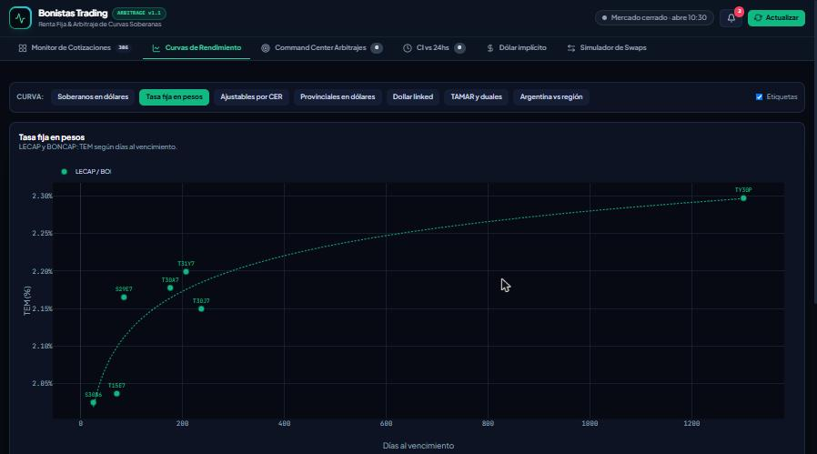 |

**Provinciales en dólares**: TIR calculada con flujos de Bruno618 y precios de BYMA. Provincia de Buenos Aires va en su propia serie.

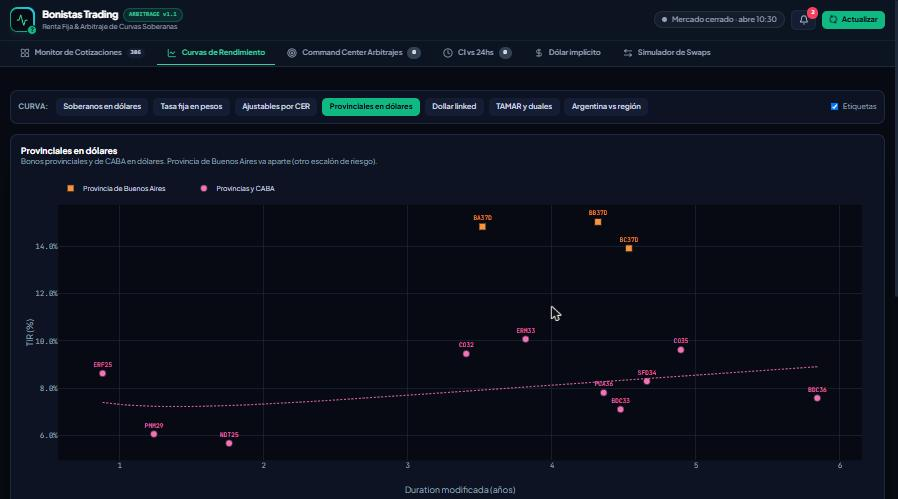

**Argentina vs región**: Globales argentinos contra soberanos de Latinoamérica y la curva de Treasuries (riesgo país por tramo).

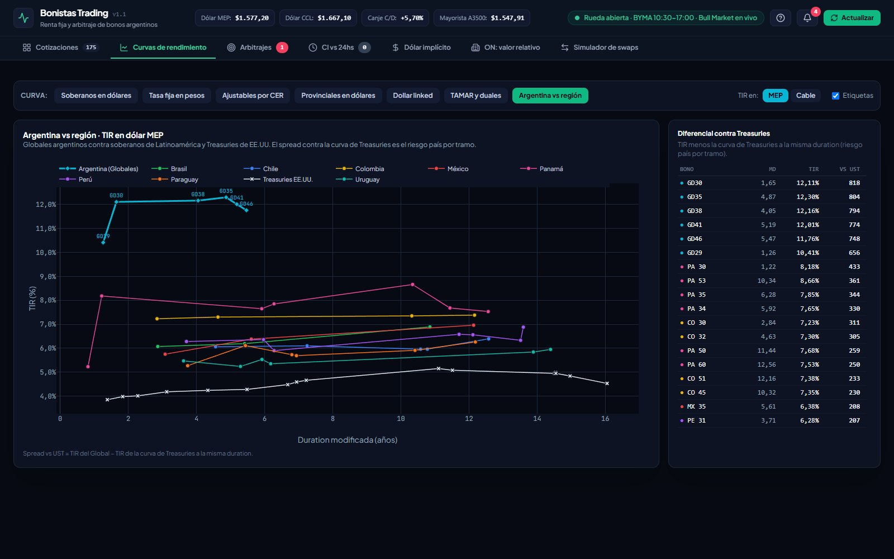

### Contado Inmediato vs 24hs
Escáner de todas las especies con puntas en ambos plazos: bruto, costos, caución, ajuste por cupón y neto.

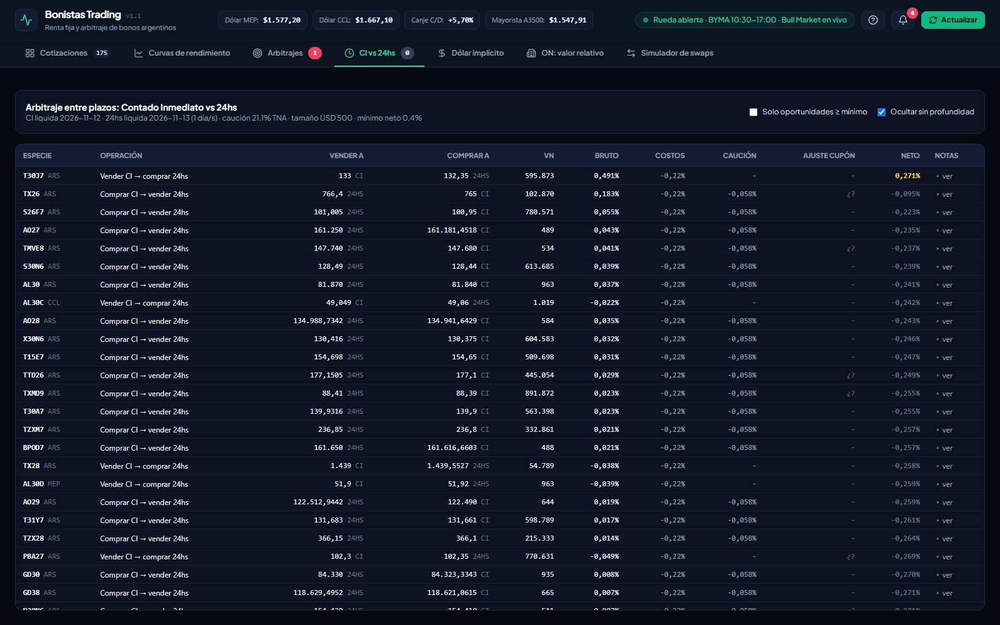

### Dólar implícito ejecutable
Qué bono conviene para comprar o vender dólares MEP / cable, y si una ida y vuelta entre dos bonos deja ganancia después de costos.

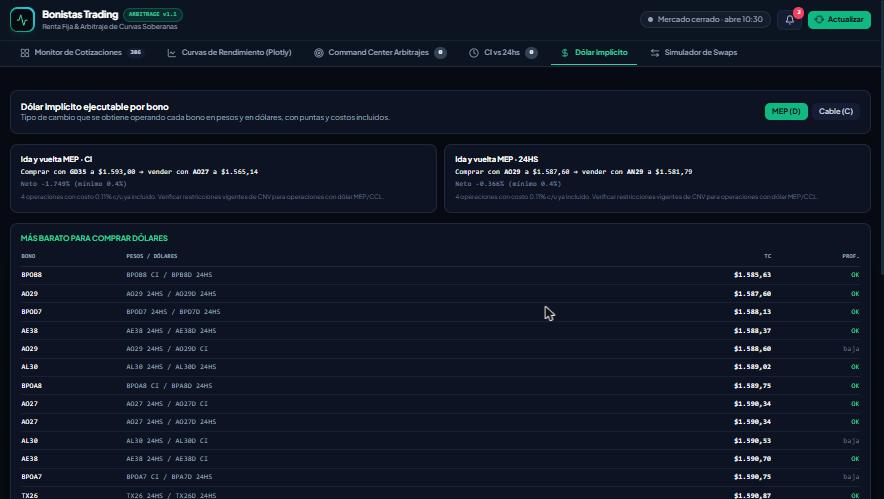

### Command Center
Parámetros operativos, conexión con Bull Market en tiempo real, señales activas y matriz de prima de legislación AL/GD.

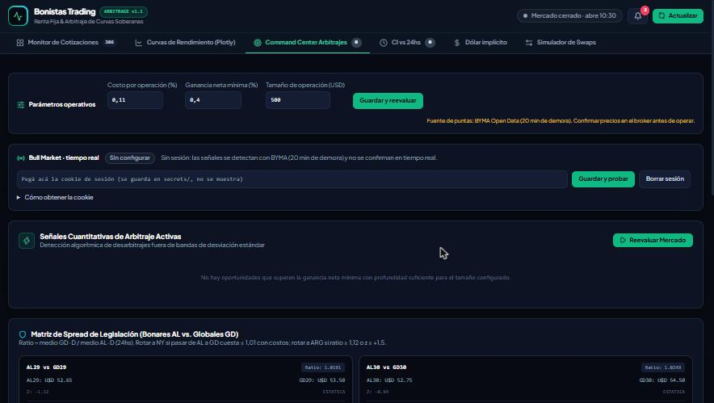

### Ratios entre bonos de la curva
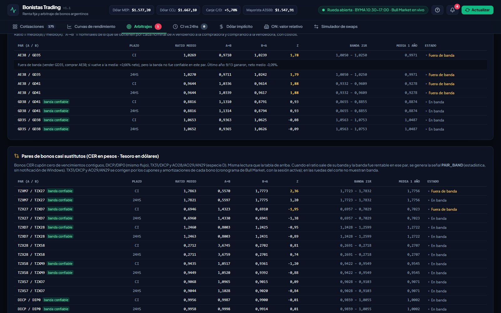

### Alertas
Historial de avisos y preferencias de notificación: notificaciones de Windows, solo confirmadas en tiempo real y aviso de fuentes caídas.

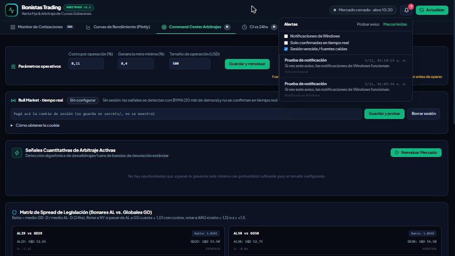

### Guía de uso integrada
Tocando el logo se abre una guía con el objetivo de la app, los primeros pasos, qué hace cada herramienta, cómo leer una señal, un glosario y las fuentes y límites. Se muestra sola la primera vez.

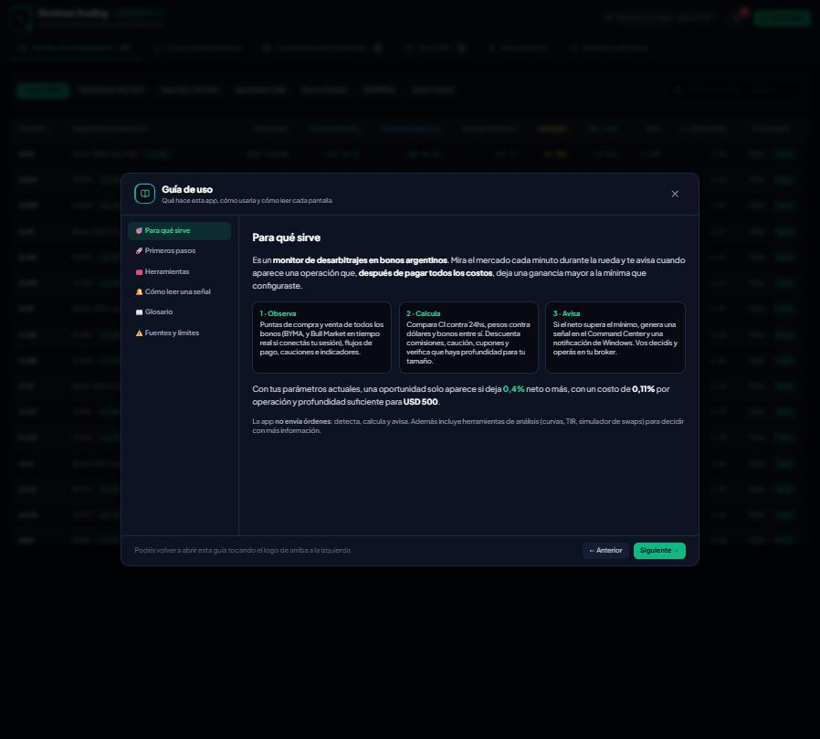

### Simulador de swaps
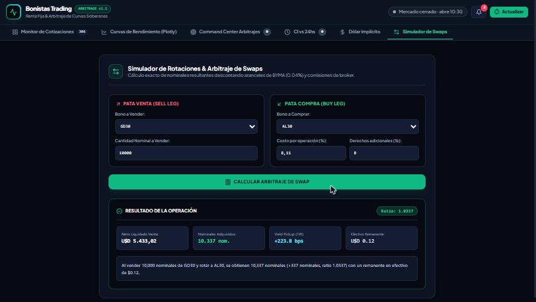

> Las capturas son del cierre del 04/11/2026, con el mercado cerrado: por eso no hay señales activas.

---

## 🚀 Instalación

Requisitos: **Python 3.11+**. Las notificaciones de escritorio requieren Windows 10/11; el resto funciona en cualquier sistema operativo.

```powershell
git clone https://github.com/bluecold/bonistas.git
cd bonistas
python -m venv .venv
.\.venv\Scripts\pip install -r requirements.txt
.\.venv\Scripts\python -m backend.main
```

Abrí **http://127.0.0.1:8050**. La documentación de la API está en `/docs`.

Al iniciar, el servidor:
1. crea o migra la base SQLite (`bonistas.db`) sin perder datos;
2. descarga los datos de referencia del día (flujos de CompararBonos, CER/TAMAR/A3500 del BCRA);
3. consulta las cotizaciones y evalúa las estrategias.

Después repite el ciclo **cada 60 segundos, solo en horario de rueda**.

### Bull Market en tiempo real (opcional)
1. Iniciá sesión en Bull Market en el navegador y abrí *Cotizaciones → Bonos*.
2. F12 → **Red** → buscá la petición `GetStockPrices` → copiá el encabezado `cookie` (o "Copiar como cURL").
3. Pegalo en el panel **Bull Market · tiempo real** del Command Center y tocá **Guardar y probar**.

La cookie se guarda **solo en tu PC** (`secrets/bullmarket_cookie.txt`, ignorado por git) y la API nunca la devuelve. El sistema **no inicia sesión por vos** ni usa tu usuario o contraseña. Cuando la sesión vence, avisa y sigue funcionando con BYMA.

---

## ⚙️ Configuración

Todas las opciones se pueden definir con variables de entorno o en un archivo `.env` (no versionado):

| Variable | Default | Descripción |
|---|---|---|
| `PORT` / `HOST` | `8050` / `127.0.0.1` | Por defecto solo escucha en esta PC. |
| `POLLING_INTERVAL_SECONDS` | `60` | Frecuencia del ciclo de mercado. |
| `MARKET_HOURS_ONLY` | `true` | Solo consulta en días hábiles y en horario de rueda (según BYMA). |
| `COMMISSION_PCT` | `0.11` | Costo por operación, todo incluido (también editable en el dashboard). |
| `MIN_NET_PROFIT_PCT` | `0.40` | Ganancia neta mínima para emitir una señal. |
| `TRADE_SIZE_USD` | `500` | Tamaño de operación para evaluar la profundidad. |
| `BULLMARKET_ENABLED` | `true` | Usar Bull Market si hay sesión. |
| `WINDOWS_NOTIFICATIONS` | `true` | Notificaciones de escritorio. |
| `DATABASE_URL` | `sqlite:///./bonistas.db` | Base de datos (SQLite en modo WAL). |

Lista completa en [PROJECT_CONTEXT.md §7](PROJECT_CONTEXT.md).

---

## 🗂️ Fuentes de datos

| Fuente | Uso | Demora |
|---|---|---|
| [BYMA Open Data](https://open.bymadata.com.ar) | Puntas CI/24hs de todos los bonos, cauciones, horario de mercado | 20 min |
| Bull Market (sesión del usuario) | Puntas con 5 niveles de profundidad | Tiempo real |
| [Bonistas.com](https://bonistas.com) | TIR, duration, paridad, valor técnico | — |
| [CompararBonos](https://compararbonos.com.ar) | Flujos de fondos y especies de cada bono | Diario |
| [Bruno618](https://bruno618.com/herramientas/flujo-de-fondos-renta-fija) | Cronogramas de provinciales en dólares que CompararBonos no publica | Diario |
| [API del BCRA](https://www.bcra.gob.ar) | CER, TAMAR, A3500 | Diario |
| [DolarAPI](https://dolarapi.com) | Dólar MEP, CCL, oficial | — |

Cada fuente se consulta con frecuencia moderada (una vez por minuto, en horario de rueda) y solo se guarda un registro nuevo cuando el dato cambió.

---

## 🏛️ Arquitectura

```
backend/
├── main.py                     # FastAPI + APScheduler (ciclo de mercado y referencia diaria)
└── app/
    ├── api/routes.py           # Endpoints REST
    ├── arbitrage/
    │   ├── market_view.py      # Libros por especie/plazo, prioridad de fuentes, cupones entre liquidaciones
    │   ├── ci_24hs.py          # Detector CI vs 24hs
    │   ├── fx_implied.py       # Dólar implícito e ida y vuelta
    │   ├── ratios.py           # Ratios AL/GD y de curva, z-score histórico
    │   └── engine.py           # Orquestación, señales persistentes, Command Center
    ├── data/                   # Clientes: BYMA, Bull Market, Bonistas, CompararBonos, BCRA, DolarAPI
    ├── quant/                  # Flujos, TIR, duration, valor técnico, swaps
    ├── services/               # Ingesta, libros, calendario, sesión Bull Market, alertas, notificador
    ├── db/                     # Modelos SQLAlchemy y migraciones mínimas
    └── static/index.html       # Dashboard (Tailwind + Plotly)
```

---

## 🧪 Tests

```powershell
.\.venv\Scripts\pytest backend/tests -q
```

211 tests. Corren **sin internet y sin tocar `bonistas.db`**: usan una base temporal y respuestas reales recortadas como fixtures. Nunca usan la cookie real ni muestran notificaciones. Los tests que consultan APIs reales están marcados `network` y solo corren con `RUN_NETWORK_TESTS=1`.

---

## 🛣️ Próximas versiones

Acciones y Merval, CEDEARs, obligaciones negociables, detector de "gangas" y alertas por Telegram. Ver [PROJECT_CONTEXT.md §6.1](PROJECT_CONTEXT.md).

Para el detalle de las decisiones financieras y técnicas, y el registro de cambios de la v1.1, ver [PROJECT_CONTEXT.md](PROJECT_CONTEXT.md).
